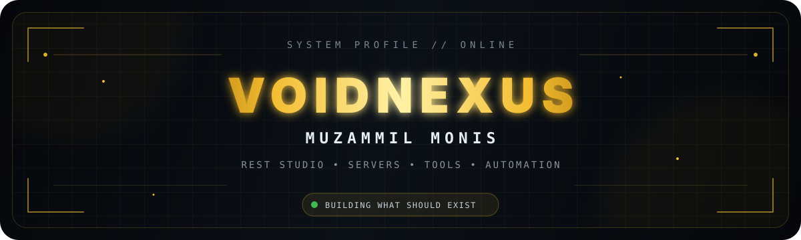

<div align="center">



<br/>

[](https://github.com/muzammilmonis)
[](https://github.com/muzammilmonis?tab=followers)
[](https://tiers.rest)
[](https://dsc.gg/resttiers)

</div>


## `> SYSTEM_MANIFEST`

```text
IDENTITY     : Muzammil Monis // VoidNexus
LAB          : REST STUDIO
MODE         : BUILD → BREAK → OPTIMIZE → SHIP
FOCUS        : Minecraft systems, backend tooling, automation, infrastructure
PHILOSOPHY   : If the tool I want does not exist, build it.
STATUS       : ONLINE
```

<div align="center">

### ⚡ ACTIVE STACK


</div>

---

## `> LIVE_TELEMETRY`

<div align="center">
  
  
</div>

<div align="center">
  
</div>

---

## `> SELECTED_BUILDS`

<table>
<tr>
<td width="50%" valign="top">

### ⚔️ [REST Tier Tagger](https://github.com/muzammilmonis/REST-Tier-Tagger)
Minecraft-side REST Tiers integration and tier-tag tooling.

`JAVA` `MINECRAFT` `REST`

</td>
<td width="50%" valign="top">

### 🧠 [EchoMind](https://github.com/muzammilmonis/EchoMind)
An experimental public build from the REST/Void workspace.

`EXPERIMENTAL` `TOOLING`

</td>
</tr>
<tr>
<td width="50%" valign="top">

### 🛰️ [rest-route](https://github.com/muzammilmonis/rest-route)
Routing-focused tooling from the REST ecosystem.

`NETWORKING` `REST`

</td>
<td width="50%" valign="top">

### 🧱 [restmc](https://github.com/muzammilmonis/restmc)
Public Minecraft systems workspace.

`MINECRAFT` `SERVER`

</td>
</tr>
<tr>
<td width="50%" valign="top">

### 🤖 [nextjs-ai-chatbot](https://github.com/muzammilmonis/nextjs-ai-chatbot)
AI/chat experimentation with a modern web stack.

`NEXT.JS` `AI` `WEB`

</td>
<td width="50%" valign="top">

### 🌐 [seednodes](https://github.com/muzammilmonis/seednodes)
Public node/infrastructure project workspace.

`INFRA` `NODES`

</td>
</tr>
</table>

<div align="center">

[](https://github.com/muzammilmonis?tab=repositories)

</div>

---

## `> ACTIVITY_GRID // LIVE DATA`

<div align="center">

<p><i>The animation below is generated from the real GitHub contribution grid.</i></p>

<picture>
  <source media="(prefers-color-scheme: dark)" srcset="https://raw.githubusercontent.com/muzammilmonis/muzammilmonis/output/github-contribution-grid-snake-dark.svg" />
  <source media="(prefers-color-scheme: light)" srcset="https://raw.githubusercontent.com/muzammilmonis/muzammilmonis/output/github-contribution-grid-snake.svg" />
  
</picture>

</div>

---

## `> SIGNAL_MAP`

<div align="center">


</div>

---

## `> REST_NETWORK`

<div align="center">

| SYSTEM | ENDPOINT | STATE |
|:--|:--|:--:|
| REST Tiers | [tiers.rest](https://tiers.rest) | `ONLINE` |
| REST Community | [dsc.gg/resttiers](https://dsc.gg/resttiers) | `ACTIVE` |
| GitHub Lab | [muzammilmonis](https://github.com/muzammilmonis) | `BUILDING` |

<br/>

```text
╔══════════════════════════════════════════════════════════════╗
║  THE GRAPH IS A SIDE EFFECT. THE SYSTEMS ARE THE POINT.     ║
╚══════════════════════════════════════════════════════════════╝
```

<sub>Designed as a custom profile interface for <b>muzammilmonis</b> • REST STUDIO</sub>

</div>
