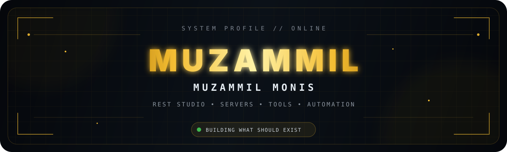
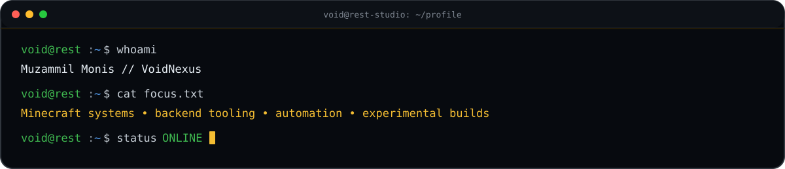

<div align="center">



<br/>

[](https://github.com/muzammilmonis)
[](https://github.com/muzammilmonis?tab=followers)
[](https://tiers.rest)
[](https://dsc.gg/resttiers)

</div>



<br/>



## `> SYSTEM_MANIFEST`

```text
IDENTITY     : Muzammil Monis // @muzammilmonis
LAB          : REST STUDIO
MODE         : BUILD → BREAK → OPTIMIZE → SHIP
FOCUS        : Minecraft systems / backend tooling / automation / infrastructure
STATUS       : ONLINE
```

<div align="center">

### `// ACTIVE TOOLCHAIN`


</div>

---

## `> LIVE_TELEMETRY`

<div align="center">
  
  
</div>

<div align="center">
  
</div>

---

## `> CONTRIBUTION_STREAM // LIVE`

<div align="center">

<sub>Generated automatically from the GitHub contribution calendar.</sub>

<br/><br/>

<picture>
  <source media="(prefers-color-scheme: dark)" srcset="https://raw.githubusercontent.com/muzammilmonis/muzammilmonis/gh-pages/github-contribution-grid-snake-dark.svg" />
  <source media="(prefers-color-scheme: light)" srcset="https://raw.githubusercontent.com/muzammilmonis/muzammilmonis/gh-pages/github-contribution-grid-snake.svg" />
  
</picture>

<br/><br/>


</div>

---

## `> SELECTED_BUILDS`

<table>
<tr>
<td width="50%" valign="top">

### ⚔️ [REST Tier Tagger](https://github.com/muzammilmonis/REST-Tier-Tagger)
Minecraft-side REST Tiers integration and tier-tag tooling.

`JAVA` `MINECRAFT` `REST`

</td>
<td width="50%" valign="top">

### 🧱 [RestServer](https://github.com/muzammilmonis/RestServer)
Minecraft server runtime and performance work.

`JAVA` `SERVER` `PERFORMANCE`

</td>
</tr>
<tr>
<td width="50%" valign="top">

### 🛰️ [rest-route](https://github.com/muzammilmonis/rest-route)
Routing and networking tooling from the REST ecosystem.

`NETWORKING` `ROUTING` `REST`

</td>
<td width="50%" valign="top">

### 🌍 [restmc](https://github.com/muzammilmonis/restmc)
Minecraft systems workspace and experiments.

`MINECRAFT` `SERVER` `TOOLS`

</td>
</tr>
<tr>
<td width="50%" valign="top">

### 🧠 [EchoMind](https://github.com/muzammilmonis/EchoMind)
Experimental public tooling from REST Studio.

`EXPERIMENTAL` `TOOLING`

</td>
<td width="50%" valign="top">

### ⚡ [Nyra](https://github.com/muzammilmonis/Nyra)
Active public build and experimentation workspace.

`BUILD` `EXPERIMENT`

</td>
</tr>
</table>

<div align="center">

[](https://github.com/muzammilmonis?tab=repositories)

</div>

---

## `> REST_NETWORK`

<div align="center">

| SYSTEM | ENDPOINT | STATE |
|:--|:--|:--:|
| **REST Tiers** | [tiers.rest](https://tiers.rest) | `ONLINE` |
| **REST Community** | [dsc.gg/resttiers](https://dsc.gg/resttiers) | `ACTIVE` |
| **GitHub Lab** | [@muzammilmonis](https://github.com/muzammilmonis) | `BUILDING` |

</div>

<details>
<summary><b>▸ ACCESS // BUILD PRINCIPLES</b></summary>
<br/>

```text
01. Build the thing instead of waiting for it.
02. Automate repetitive work until the machine complains instead.
03. Keep infrastructure observable and recoverable.
04. Treat experiments as disposable; treat useful systems as products.
05. The contribution graph is telemetry. The systems are the point.
```

</details>

<br/>

<div align="center">



<sub><b>REST STUDIO</b> // engineered by <b>Muzammil Monis</b> // <b>@muzammilmonis</b></sub>

</div>
